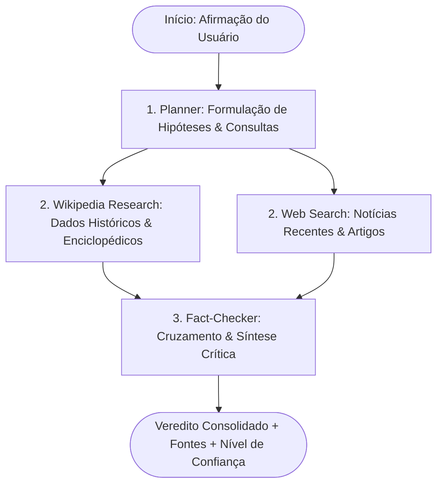

# 🔍 LangAgent — Finesse Checking

> **Agente Autônomo de Fact-Checking e Jornalismo Investigativo em Tempo Real** desenvolvido com LangGraph, Groq, Turso (LibSQL), FastAPI e React 19.

---

## 📌 Sobre o Projeto

O **LangAgent (Finesse Checking)** é uma plataforma que investiga a veracidade de afirmações, notícias e dados públicos. Utilizando uma arquitetura de grafos com **LangGraph**, o agente planeja a investigação, cruza dados enciclopédicos (Wikipédia) com notícias recentes da web (DuckDuckGo) e emite um veredito fundamentado com nível de confiança e fontes verificáveis.

Todo o progresso cognitivo do agente e a geração da análise final são transmitidos em tempo real para o usuário via **Server-Sent Events (SSE)**.

---

## 🧠 Arquitetura do Agente Investigativo



1. **Planner (`planner`)**: Analisa semanticamente a alegação e determina termos de busca otimizados para enciclopédia e web aberta.
2. **Researcher (`wikipedia_search` e `web_search`)**: Coleta evidências documentais em fontes primárias e secundárias.
3. **Fact-Checker (`fact_checker`)**: Sintetiza as evidências, identifica contradições ou consensos e emite um veredito (*Verdadeiro*, *Falso*, *Parcialmente Verdadeiro* ou *Inconclusivo*).

---

## 🚀 Tecnologias Utilizadas

### Backend
* **Linguagem & Framework:** Python 3.11, [FastAPI](https://fastapi.tiangolo.com/) (assíncrono)
* **Orquestração de Agentes:** [LangGraph](https://www.langchain.com/langgraph) & [LangChain](https://www.langchain.com/)
* **Infras de Inferência (LLM):** [Groq API](https://groq.com/) (altíssima velocidade com modelos de ponta)
* **Banco de Dados:** [Turso](https://turso.tech/) (SQLite distribuído sobre LibSQL com `libsql-client`)
* **Segurança & Autenticação:**
  * Hashing de senhas: **Bcrypt** (salt rounds 12)
  * Tokens de Sessão: **PyJWT** (JSON Web Tokens)
* **Streaming:** Server-Sent Events (SSE) para streaming token-a-token e status dos nós

### Frontend
* **Core:** React 19, TypeScript
* **Build Tool:** Vite
* **Estilização:** Tailwind CSS v4 (Dark Theme moderno e minimalista)
* **Ícones:** Lucide React
* **Gerenciamento de Estado:** Context API (`AuthContext`) e Hooks customizados (`useFactCheck`)

---

## 🗄️ Esquema do Banco de Dados (Turso / LibSQL)

A aplicação utiliza o banco serverless distribuído **Turso**:

```sql
CREATE TABLE IF NOT EXISTS users (
    id TEXT PRIMARY KEY,               -- UUID v4
    name TEXT NOT NULL,                -- Nome de exibição
    email TEXT NOT NULL UNIQUE,        -- E-mail normalizado
    password_hash TEXT NOT NULL,       -- Hash Bcrypt seguro
    created_at TEXT NOT NULL DEFAULT (CURRENT_TIMESTAMP)
);

CREATE INDEX IF NOT EXISTS idx_users_email ON users(email);
```

> As tabelas são verificadas e criadas automaticamente no ciclo de vida (*lifespan*) da API FastAPI ao iniciar.

---

## 🔒 Variáveis de Ambiente & Segurança

O arquivo `.env` do backend armazena as credenciais sensíveis de forma isolada:

```env
# Groq Cloud API
GROQ_API_KEY=gsk_sua_chave_groq_aqui
GROQ_MODEL=openai/gpt-oss-120b

# Banco de Dados Turso (LibSQL)
# Utilize libsql://... para produção ou file:local.db para SQLite local
TURSO_DATABASE_URL=libsql://seu-banco-org.turso.io
TURSO_AUTH_TOKEN=seu_token_turso_aqui

# Autenticação JWT
JWT_SECRET_KEY=sua_chave_jwt_secreta_e_longa_32_bytes
JWT_ALGORITHM=HS256
ACCESS_TOKEN_EXPIRE_MINUTES=1440
```

---

## 💻 Como Rodar o Projeto Localmente

### Pré-requisitos
* **Python 3.11+**
* **Node.js 18+** & **npm**

### 1. Clonando o Repositório
```bash
git clone https://github.com/Pedro-Beserra/LangAgent.git
cd LangAgent
```

### 2. Configurando o Backend
```bash
cd backend

# Criar e ativar ambiente virtual
python -m venv .venv
# No Windows PowerShell:
.\.venv\Scripts\Activate.ps1
# No Linux/Mac:
source .venv/bin/activate

# Instalar dependências
pip install -r requirements.txt

# Configurar variáveis de ambiente
cp .env.example .env
# Edite o .env com sua GROQ_API_KEY e credenciais do Turso

# Iniciar o servidor
python main.py
```
A API estará disponível em: `http://localhost:8000` (Documentação Swagger: `http://localhost:8000/docs`).

### 3. Configurando o Frontend
Em outro terminal:
```bash
cd frontend

# Instalar dependências
npm install

# Iniciar servidor de desenvolvimento
npm run dev
```
Acesse a aplicação em `http://localhost:5173`.

---

## 📡 Rotas Principais da API

| Método | Rota | Descrição | Autenticação |
|---|---|---|---|
| `POST` | `/api/auth/register` | Cadastra novo usuário e retorna token JWT | Pública |
| `POST` | `/api/auth/login` | Autentica e-mail/senha e emite token JWT | Pública |
| `GET` | `/api/auth/me` | Retorna o perfil do usuário atual | Bearer Token |
| `POST` | `/api/check` | Executa checagem de fatos consolidada | Opcional |
| `POST` | `/api/check/stream` | Executa checagem com streaming SSE em tempo real | Opcional |
| `GET` | `/api/health` | Status de saúde da aplicação | Pública |

---

## 📄 Licença

Distribuído sob a licença MIT. Consulte `LICENSE` para obter mais informações.
